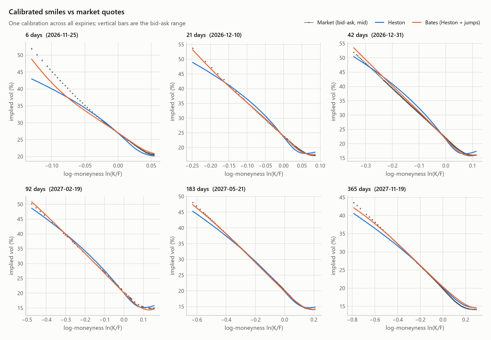
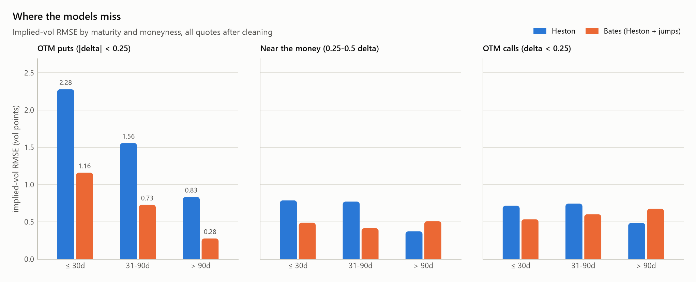
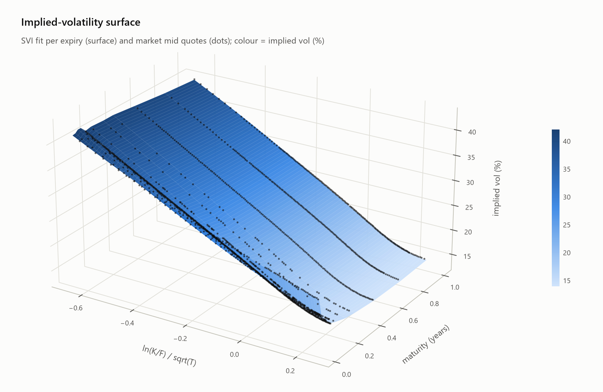
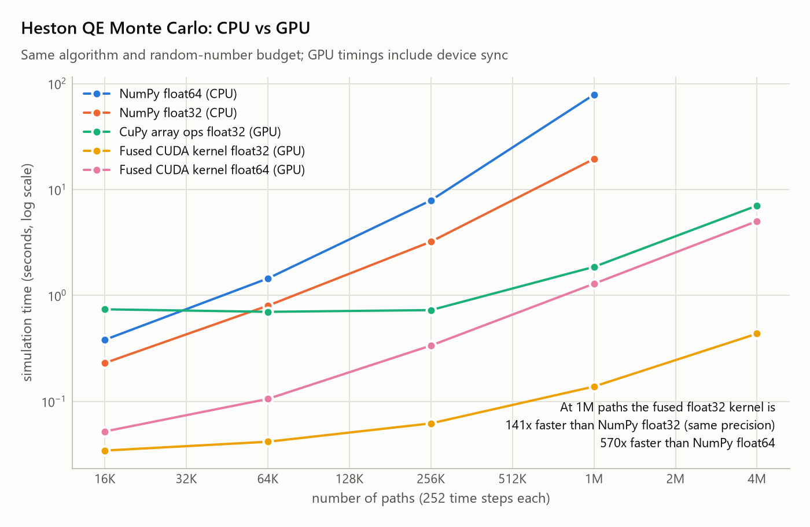
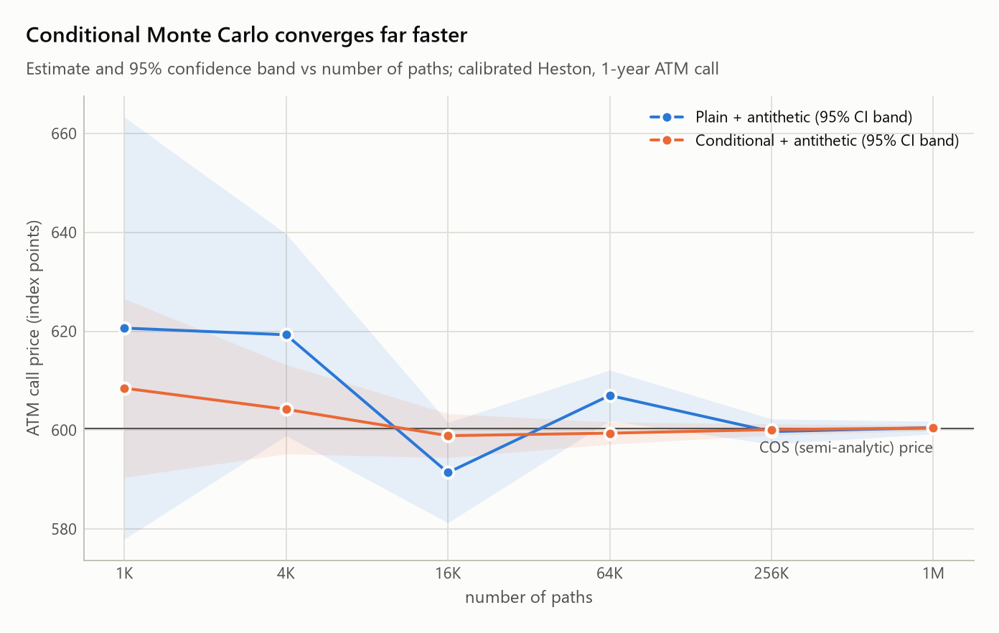

# GPU Options Pricing & Volatility-Surface Engine

[](https://github.com/puneethakshay00-cpu/gpu-options-engine/actions/workflows/tests.yml)
 

**Calibrates a stochastic-volatility model (Heston) and a jump-diffusion model (Bates) to the live S&P 500 (SPX) option surface, then prices options with a CUDA Monte Carlo engine validated against a semi-analytic Fourier (COS) pricer.**

<picture>
  <source media="(prefers-color-scheme: dark)" srcset="results/figures/smile_fits_dark.png">
  
</picture>

## Results — SPX close, 19 Nov 2026 (1,734 quotes, 11 expiries, 6–365 days)

| Calibration (one parameter set for the whole surface) | Heston | Bates (Heston + jumps) |
|---|---|---|
| Implied-vol RMSE, all quotes | 1.07 vol pts | **0.61 vol pts** (43% lower) |
| Implied-vol RMSE, OTM puts ≤ 30 days | 2.28 vol pts | **1.16 vol pts** (49% lower) |
| Calibration time | 3.1 s (8 starts) | 8.6 s (8 starts) |

| Monte Carlo — Heston QE scheme, 252 steps; RTX 3050 6GB Laptop GPU vs AMD Ryzen 7 7445HS | |
|---|---|
| Fused CUDA kernel vs NumPy, 1M paths, **same float32 precision** | **141× faster** (19.5 s → 0.138 s) |
| Fused CUDA kernel (float32) vs NumPy float64 | 570× faster |
| Fused kernel vs the same maths as CuPy array operations | 13.5× faster |
| Conditional MC variance reduction, ATM / 20% OTM call | 6.4× / 95× |
| Time to a 1 bp standard error on the ATM call | 22.7 s (NumPy, plain MC) → 72 ms (GPU, conditional MC): **317×** |
| Agreement with the COS price (GPU, 1M paths, 10 checks) | every price within 1.9 standard errors |

**Finding.** Heston's error concentrates in short-dated out-of-the-money puts: a diffusion cannot build a steep enough skew over a few weeks. Adding jumps cuts that error by 49%, and the calibrated jump component is a *rare crash*: about 0.06 jumps a year with a median size of −48% ($\mu_J = -0.66$, $\delta_J = 0.47$). The short end of the SPX surface is pricing crash protection. The gain is not free: with one parameter set for the whole surface, Bates gives back some accuracy on long-dated quotes (>90-day near-the-money: 0.37 → 0.51; >90-day out-of-the-money calls: 0.48 → 0.67). Write-up: [docs/research_note.md](docs/research_note.md).

<picture>
  <source media="(prefers-color-scheme: dark)" srcset="results/figures/error_buckets_dark.png">
  
</picture>

<picture>
  <source media="(prefers-color-scheme: dark)" srcset="results/figures/vol_surface_dark.png">
  
</picture>

<picture>
  <source media="(prefers-color-scheme: dark)" srcset="results/figures/mc_benchmark_dark.png">
  
</picture>

<picture>
  <source media="(prefers-color-scheme: dark)" srcset="results/figures/mc_convergence_dark.png">
  
</picture>

Every number above is in [results/RESULTS.md](results/RESULTS.md) and `results/summary.json`, generated by the pipeline from the saved snapshot `data/SPX_20261120_0412.csv`.

## What's inside

- **Data engineering for options**: SPX chain → forwards and discount factors from put–call parity (robust Theil–Sen + weighted least squares, no rate or dividend assumptions), settlement-time-aware maturities (AM vs PM), out-of-the-money quotes with liquidity filters, and a smile-consistency filter (quotes more than 6 robust SDs off their expiry's SVI fit are dropped; 2 of 1,736 here).
- **Implied volatility**: vectorised safeguarded-Newton solver, accurate to 1e-8 wherever the price still carries volatility information.
- **Arbitrage-aware surface**: SVI per expiry with Durrleman butterfly and calendar checks (11/11 slices butterfly-free, 0 calendar violations).
- **Semi-analytic pricing**: Heston and Bates through the COS method; an entire expiry priced with one matrix–vector product; verified against direct integration.
- **Calibration**: vega-weighted least squares, equal weight per expiry, multi-start (it matters: the best Bates fit is found only from crash-type starting points).
- **GPU Monte Carlo**: Andersen QE scheme with martingale correction, a hand-written fused CUDA kernel (CuPy `ElementwiseKernel`), antithetic and conditional Monte Carlo, float32/float64.
- **Engineering**: 32 tests (incl. GPU tests) run in CI, reproducible runs from saved snapshots, a Streamlit dashboard, light/dark figures.

## How it works

### 1. Market data → forwards and implied vols (`data.py`, `black_scholes.py`)

* Downloads calls and puts for ~11 SPX expiries (1 week to 1 year) from Yahoo Finance and saves the raw snapshot to `data/` so every number in this README can be reproduced with `--snapshot`.
* **SPX, not SPY**: SPX options are European and cash-settled; SPY options are American, so their prices contain an early-exercise premium a European model should not be fitted to. PM-settled SPXW contracts are preferred, and time to expiry runs to the actual settlement time.
* **Forward and discount factor from put–call parity**, so no assumption about rates or dividends is needed. The fit is robust: a Theil–Sen line on near-the-money strikes (the band widens with $\sqrt{T}$), removal of quotes more than 5 robust SDs off it, then weighted least squares. Below about a month the discount factor is not identified by parity, so those expiries use the median implied rate of the longer ones:

$$C(K) - P(K) = D\,(F - K)$$

* Out-of-the-money quotes only, with liquidity filters (bid > 0, relative spread, $|\Delta| \ge 0.02$).
* Implied vols from a vectorised **safeguarded Newton** solver (Newton steps inside a shrinking bisection bracket), which converges for deep out-of-the-money options where plain Newton diverges.

### 2. Arbitrage-aware surface (`svi.py`)

Gatheral's raw SVI per expiry, $w(k) = a + b\left(\rho(k-m) + \sqrt{(k-m)^2+\sigma^2}\right)$ with $w = \sigma_{BS}^2 T$, checked for butterfly arbitrage (Durrleman's condition $g(k) \ge 0$) and calendar arbitrage (total variance non-decreasing in $T$). The SVI fit doubles as a data filter: quotes more than 6 robust standard deviations from their own smile are treated as stale and dropped before calibration.

### 3. Models (`models.py`)

Heston: $\dfrac{dS_t}{S_t} = \sqrt{v_t}\,dW^{(1)}_t,\quad dv_t = \kappa(\theta - v_t)\,dt + \sigma\sqrt{v_t}\,dW^{(2)}_t,\quad d\langle W^{(1)},W^{(2)}\rangle_t = \rho\,dt$

Bates = Heston + compensated lognormal jumps in the price, intensity $\lambda$, log-jump size $J \sim N(\mu_J, \delta_J^2)$:

$$\ln \varphi_{\text{Bates}}(u) = \ln \varphi_{\text{Heston}}(u) + \lambda T\left(e^{iu\mu_J - \frac12 \delta_J^2 u^2} - 1 - iu\left(e^{\mu_J + \frac12\delta_J^2} - 1\right)\right)$$

Characteristic functions are written for the log-return of the forward, so $E[e^{X_T}] = 1$ and rates/dividends drop out. The Heston CF uses the "little Heston trap" form (Albrecher et al., 2007), which stays on the right branch of the complex logarithm.

### 4. Semi-analytic pricing with the COS method (`cos.py`)

Fang & Oosterlee (2008): expand the density of $y = \ln(S_T/K)$ in a cosine series on $[a,b]$:

$$V \approx D \sum_{k=0}^{N-1}{}^{'}\ \operatorname{Re}\!\left[\varphi\!\left(\tfrac{k\pi}{b-a}\right) e^{\,i k\pi \frac{x-a}{b-a}}\right] V_k$$

* The range is shifted per strike so $b-a$ is the same for every strike: one CF evaluation per expiry, then **all strikes in one matrix–vector product**.
* Truncation from the model's own cumulants, $c_1 \pm L\sqrt{c_2 + \sqrt{|c_4|}}$ — the $c_4$ term matters for fat-tailed (jump) densities.
* Verified against direct numerical integration (Lewis 2001) to better than $10^{-6}$ in implied-vol terms across maturities from 1 week to 2 years.

### 5. Calibration (`calibration.py`)

Vega-weighted least squares, which approximates implied-vol errors without inverting model prices at every step, with equal total weight per expiry:

$$\min_\Theta \sum_{j}\frac{1}{n_j}\sum_{i \in j}\left(\frac{P^{\text{model}}_i(\Theta) - P^{\text{mid}}_i}{\mathcal{V}_i}\right)^2$$

Multi-start trust-region optimisation (8 starts per model; the Bates starts are seeded from the Heston fit and include rare-crash jump regimes, which is where the best SPX fit lives), with cached COS payoff matrices and a final "range refresh" at the optimum.

### 6. Monte Carlo on the GPU (`mc.py`)

* **Andersen's QE scheme** for the variance (moment-matched quadratic / exponential branches) — the standard choice when the **Feller condition** $2\kappa\theta \ge \sigma^2$ fails, as it does for calibrated SPX parameters.
* **Martingale correction** on the log-price step, so $E[S_T] = F$ holds exactly in discrete time.
* The same code runs on NumPy or CuPy; on the GPU the whole QE step is **one fused CUDA kernel** per time step (instead of ~40 array operations).
* **Conditional Monte Carlo** (Willard 1997; Romano & Touzi 1997): given the variance path, $\ln S_T$ is Gaussian, so the inner expectation is a Black price and only the variance path adds noise:

$$\tilde F = F\exp\!\Big(\rho I - \tfrac12\rho^2 \textstyle\int_0^T v_t\,dt\Big),\qquad I = \dfrac{v_T - v_0 - \kappa\theta T + \kappa\int_0^T v_t\,dt}{\sigma},\qquad \bar w = (1-\rho^2)\textstyle\int_0^T v_t\,dt$$

* Antithetic variates, with standard errors computed on pair averages (pairs are not independent).

## Run it

```bash
python -m venv .venv && source .venv/bin/activate        # Windows: .venv\Scripts\activate
pip install -r requirements.txt
pip install -r requirements-gpu.txt                       # optional: NVIDIA GPU (CUDA 12)
python run_pipeline.py                                    # live SPX snapshot -> results/
python run_pipeline.py --snapshot latest                  # reproduce the published numbers
python run_pipeline.py --synthetic --quick                # offline smoke test
python -m pytest -q
streamlit run app/dashboard.py                            # interactive dashboard
```

Without a GPU everything runs on NumPy and the GPU tests are skipped.

## Project layout

```
options_engine/
  black_scholes.py   Black-76 pricing, Greeks, safeguarded-Newton implied vol
  models.py          Heston / Bates parameters and characteristic functions
  cos.py             COS pricer: all strikes of an expiry in one matrix-vector product
  mc.py              QE Monte Carlo, fused CUDA kernel, antithetic + conditional MC
  svi.py             SVI fits, butterfly and calendar arbitrage checks
  data.py            SPX chain download, put-call-parity forwards, cleaning
  calibration.py     multi-start vega-weighted calibration, error attribution
  benchmark.py       CPU/GPU timing, validation vs COS, variance-reduction studies
  plots.py           figures (light and dark)
  synthetic.py       option chain from known Bates parameters (tests, offline runs)
  pipeline.py        end-to-end run -> results/
app/dashboard.py     Streamlit dashboard (surface, smiles, fit quality, pricer, GPU benchmark)
tests/               unit + integration tests, including GPU-vs-CPU and MC-vs-COS
data/                saved SPX snapshot used for the published results
results/             summary.json, RESULTS.md, figures (CSV outputs are regenerated by the pipeline)
```

## Tests

`pytest` covers: put–call parity and implied-vol round trips; COS vs direct numerical integration (Heston and Bates, 1 week to 2 years); the Black–Scholes limit; martingale property of the characteristic functions; cumulants against closed-form jump-diffusion values; QE Monte Carlo (plain and conditional) against COS; the martingale correction; variance reduction; fused GPU kernel = array-operation version (same random numbers); recovery of known Bates parameters from a noisy synthetic chain; SVI arbitrage checks.

## Limitations and next steps

- Quotes are Yahoo Finance end-of-day snapshots (delayed, not tick-synchronous), and one snapshot says nothing about parameter stability over time.
- The CPU baseline is vectorised single-threaded NumPy; a multithreaded C++ implementation would narrow the GPU gap, so the same-precision float32 comparison is the fair one.
- Consumer GPUs run float64 far slower than float32 (9.3× here); prices are averaged in float64 either way.
- Heston/Bates leave visible structure in the residuals; natural next steps are rough volatility (rBergomi), local-stochastic volatility, and Greeks by pathwise / adjoint differentiation on the GPU.

## References

- Heston (1993), *A closed-form solution for options with stochastic volatility*. Bates (1996), *Jumps and stochastic volatility*.
- Fang & Oosterlee (2008), *A novel pricing method for European options based on Fourier-cosine series expansions*.
- Albrecher, Mayer, Schoutens & Tistaert (2007), *The little Heston trap*. Lewis (2001), *A simple option formula for general jump-diffusion and other exponential Lévy processes*.
- Andersen (2008), *Simple and efficient simulation of the Heston stochastic volatility model*.
- Willard (1997), *Calculating prices and sensitivities for path-independent derivative securities in multifactor models*; Romano & Touzi (1997).
- Gatheral (2006), *The Volatility Surface*; Gatheral & Jacquier (2014), *Arbitrage-free SVI volatility surfaces*.

## Author

**Puneeth Kompally** · [LinkedIn](https://www.linkedin.com/in/puneethkompally) · [GitHub](https://github.com/puneethakshay00-cpu)

Released under the MIT License.
